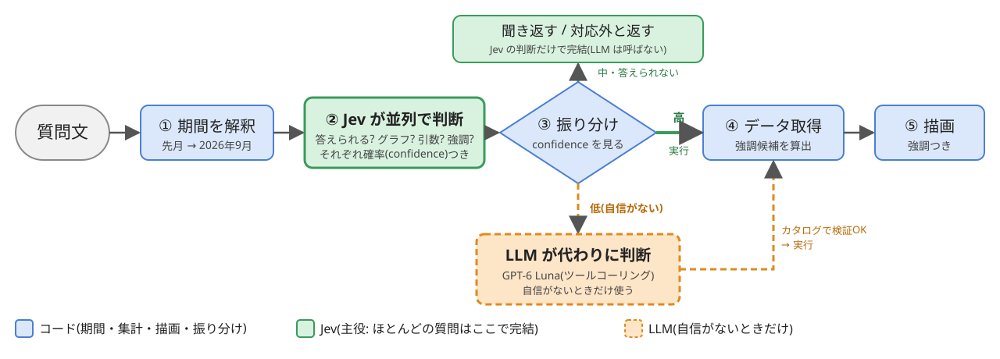
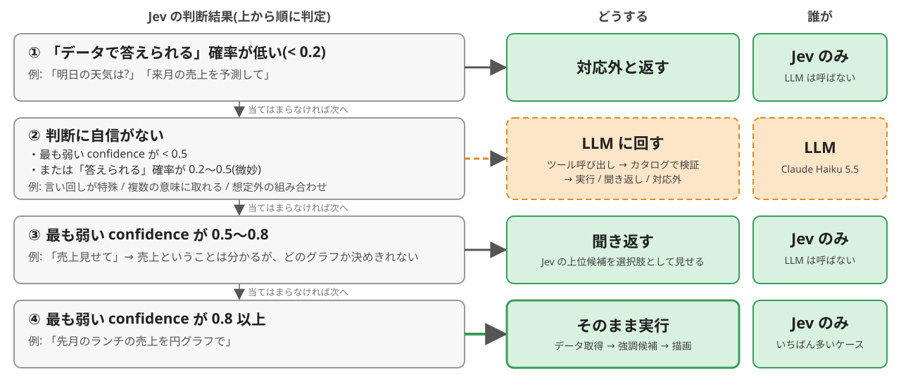
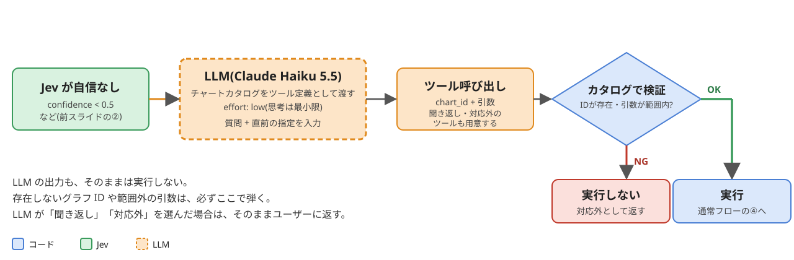

# AIに聞く：Jev と LLM の使い分け

自然言語の質問 → 適したグラフを選んで表示 → 重要な部分を強調

**ほとんどの質問は Jev だけで完結。LLM は「Jev が自信を持てないとき」だけ使う。**

| 担当 | 役割 | 使うとき |
|---|---|---|
| **コード** | 期間の解釈、集計、強調候補の算出、描画、振り分け | 常に |
| **Jev** | グラフ・引数・強調の選択、答えられるかの判定 | 常に(主役) |
| **LLM** | Jev の代わりに判断する | Jev が自信を持てないときだけ |

---

# 全体像

---

# いつ Jev だけで済み、いつ LLM に回すか

---

# LLM に回ったときの流れ

---

# 例：質問ごとの経路

(confidence の数値は仮)

| 質問 | Jev の判断 | 経路 | 結果 |
|---|---|---|---|
| 「先月のランチの売上を円グラフで」 | 最も弱い 0.88 | ④ そのまま実行(**Jev のみ**) | ランチの円グラフ |
| 「売上見せて」 | 最も弱い 0.62 | ③ 聞き返す(**Jev のみ**) | 「日別・月別・年間のどれですか?」 |
| 「明日の天気は?」 | 答えられる 0.04 | ① 対応外(**Jev のみ**) | 「このデータでは答えられません」 |
| 「夜だけ、去年の同じ月と比べたラーメンの動き」 | 最も弱い 0.31 | ② **LLM に回す** → 検証OK | 比較グラフ |

---

# 実行したあと：データ取得と強調

LLM に回った場合も、検証を通れば同じ流れ。

- **データ取得**: カタログの `render` に必要なデータを、既存の Utils / Facade で取得
- **強調候補の算出(コード)**: 最大値、最小値、前期比の変化が最大の点、外れ値
- **強調の種類を決める(Jev)**: 質問の趣旨から「最大 / 最小 / 変化が大きい点 / なし」を選ぶ
- **描画**: 強調対象以外を薄くし、対象にラベルを付ける(円グラフは少し切り離す)

Jev に強調箇所そのものを生成させない。**候補はコードが出し、Jev は種類を選ぶだけ。**

---

# 補足

- しきい値(0.2 / 0.5 / 0.8)は仮置き。日本語の質問サンプルで実測して決める
- 期間の解釈(「先月」「去年の夏」)は、Jev が日付を苦手とするため、Jev に渡す前にコードで行う
- 直前のグラフ指定(`previous_request`)があれば、Jev・LLM の両方に渡す(画面更新で消える)
- LLM の出力もそのままは実行せず、カタログで検証してから実行する

詳細設計: `design.md`
